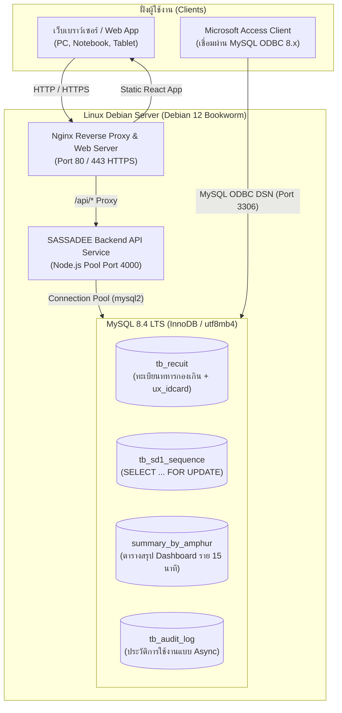

# คู่มือการติดตั้งและวางระบบงานสัสดี (SASSADEE NAN) บน Linux Debian & MySQL 8.4

คู่มือนี้ปรับปรุงล่าสุดสำหรับการวางระบบ **SASSADEE NAN Web Application** ร่วมกับฐานข้อมูล **MySQL 8.4 LTS** บนระบบปฏิบัติการ **Linux Debian (Debian 11 "Bullseye" / Debian 12 "Bookworm")** และเชื่อมต่อกับ Microsoft Access ผ่าน MySQL Connector/ODBC

---

## 1. ข้อมูลสถาปัตยกรรมระบบ (System Architecture)



---

## 2. วิธีติดตั้งผ่าน Docker & Docker Compose (แนะนำที่สุด ⭐)

ด้วย `docker-compose.yml` ที่จัดเตรียมไว้ ระบบจะติดตั้งทั้ง **MySQL 8.4 LTS**, **Node.js API**, และ **Nginx + React** ให้ครบถ้วนในคำสั่งเดียว

### 2.1 ติดตั้ง Docker บน Debian
```bash
sudo apt update && sudo apt upgrade -y
sudo apt install -y ca-certificates curl gnupg lsb-release

# เพิ่ม Docker Official GPG Key และ Repository
sudo mkdir -p /etc/apt/keyrings
curl -fsSL https://download.docker.com/linux/debian/gpg | sudo gpg --dearmor -o /etc/apt/keyrings/docker.gpg
echo "deb [arch=$(dpkg --print-architecture) signed-by=/etc/apt/keyrings/docker.gpg] https://download.docker.com/linux/debian $(lsb_release -cs) stable" | sudo tee /etc/apt/sources.list.d/docker.list > /dev/null

sudo apt update
sudo apt install -y docker-ce docker-ce-cli containerd.io docker-compose-plugin
```

### 2.2 นำโค้ดขึ้น Server และสั่งเริ่มระบบ
```bash
# คัดลอกโฟลเดอร์โปรเจกต์ไปไว้ที่ /var/www/sassadee
sudo mkdir -p /var/www/sassadee
sudo chown -R $USER:$USER /var/www/sassadee
cd /var/www/sassadee

# สั่ง Build และรันระบบทั้งหมด
docker compose up -d --build

# ตรวจสอบสถานะทั้ง 3 คอนเทนเนอร์ (sassadee-db, sassadee-api, sassadee-web)
docker compose ps
```

---

## 3. การปรับแต่งประสิทธิภาพ MySQL 8.4 (Database Tuning)

ในไฟล์คอนฟิก `mysql/conf.d/my.cnf` ได้ตั้งค่าที่เหมาะสมไว้ล่วงหน้าแล้ว:

| รายการตั้งค่า | ค่าที่แนะนำ | ประโยชน์ |
| :--- | :--- | :--- |
| `default-storage-engine` | `InnoDB` | รองรับ Row-level lock, Foreign Key และ Transaction เต็มรูปแบบ |
| `character-set-server` | `utf8mb4` | รองรับภาษาไทยสมบูรณ์แบบ ไม่เพี้ยน |
| `collation-server` | `utf8mb4_0900_ai_ci` | เรียงลำดับชื่อภาษาไทยตามพจนานุกรมและมาตรฐาน Unicode UCA 9.0 |
| `innodb_buffer_pool_size` | 50%–70% ของ RAM | ช่วยให้ข้อมูลทะเบียนและ Index ค้างอยู่ใน RAM อ่านได้เร็วที่สุด |
| `slow_query_log` | `1` (long_query_time = 1.0) | ตรวจจับคิวรีที่ใช้เวลาเกิน 1 วินาทีเพื่อการวิเคราะห์และใส่ Index เพิ่ม |
| `event_scheduler` | `ON` | อัปเดตตารางสรุป Dashboard (`summary_by_amphur`) อัตโนมัติทุก 15 นาที |

---

## 4. การตั้งค่า Microsoft Access เพื่อเชื่อมต่อ MySQL ผ่าน ODBC

เมื่อ MySQL เปิดทำงานที่พอร์ต 3306 ให้ตั้งค่าเครื่องคอมพิวเตอร์ที่ใช้งาน Access ดังนี้:

1. **ดาวน์โหลด MySQL Connector/ODBC 8.0 หรือ 8.4:**
   * ให้เลือกดาวน์โหลดแบบ **32-bit (x86)** หรือ **64-bit (x64)** ให้ตรงกับรุ่นของ Microsoft Access ที่ติดตั้ง
2. **สร้าง System DSN (Data Source Name):**
   * เปิด `ODBC Data Source Administrator`
   * เลือกแท็บ **System DSN** $\rightarrow$ คลิก **Add** $\rightarrow$ เลือก **MySQL ODBC 8.4 Unicode Driver**
   * กำหนดค่า:
     * Data Source Name: `SASSADEE_MYSQL`
     * TCP/IP Server: `<IP ของเครื่อง Debian>`
     * Port: `3306`
     * User: `sassadee_user`
     * Password: `sassadee_secure_pass`
     * Database: `sassadee_db`
3. **ตั้งค่าขั้นสูงใน DSN (เพื่อความเสถียรและป้องกัน Write Conflict):**
   * ในแท็บ **Details** $\rightarrow$ **Connection**:
     * ติ๊กถูกที่: `Return matched rows instead of affected rows`
     * ติ๊กถูกที่: `Treat BIGINT columns as INT`
     * Character Set: เลือก `utf8mb4`
4. **ข้อควรระวังในการเขียน Pass-Through Query ใน Access:**
   * ใช้ไวยากรณ์ของ MySQL: เช่น ใช้ `LIMIT 50` แทน `TOP 50` และใช้เครื่องหมาย backtick `` ` `` แทน `[ ]`
   * **ห้ามใช้ฟังก์ชัน VBA** (เช่น `Format()`, `IIf()`) ในประโยค `WHERE` ของตาราง Linked เพราะ Access จะดึงทั้งตารางมาประมวลผลที่เครื่องลูกข่าย

---

## 5. การสำรองข้อมูล MySQL อัตโนมัติ (Automated Backup)

สร้างสคริปต์สำรองข้อมูลรายวันโดยไม่ต้องล็อกตาราง:

```bash
sudo nano /usr/local/bin/backup_sassadee_mysql.sh
```

วางเนื้อหา:
```bash
#!/bin/bash
BACKUP_DIR="/var/backups/sassadee_mysql"
mkdir -p $BACKUP_DIR
TIMESTAMP=$(date +"%Y%m%d_%H%M%S")
FILENAME="$BACKUP_DIR/sassadee_backup_$TIMESTAMP.sql.gz"

# สำรองข้อมูลด้วย mysqldump ผ่าน Docker container
docker exec sassadee-db mysqldump -u root -psassadee_root_pass \
  --single-transaction \
  --routines \
  --events \
  --triggers \
  --default-character-set=utf8mb4 \
  sassadee_db | gzip > $FILENAME

# ลบไฟล์สำรองที่มีอายุเกิน 30 วัน
find $BACKUP_DIR -name "*.sql.gz" -mtime +30 -delete
echo "[$(date)] Backup completed: $FILENAME" >> /var/log/sassadee_backup.log
```

ตั้งสิทธิ์และเปิดตั้งเวลาผ่าน Cron:
```bash
sudo chmod +x /usr/local/bin/backup_sassadee_mysql.sh

# เพิ่มใน crontab ทำงานทุกวัน เวลา 02:00 น.
sudo crontab -e
# วางบรรทัดนี้:
0 2 * * * /usr/local/bin/backup_sassadee_mysql.sh
```
