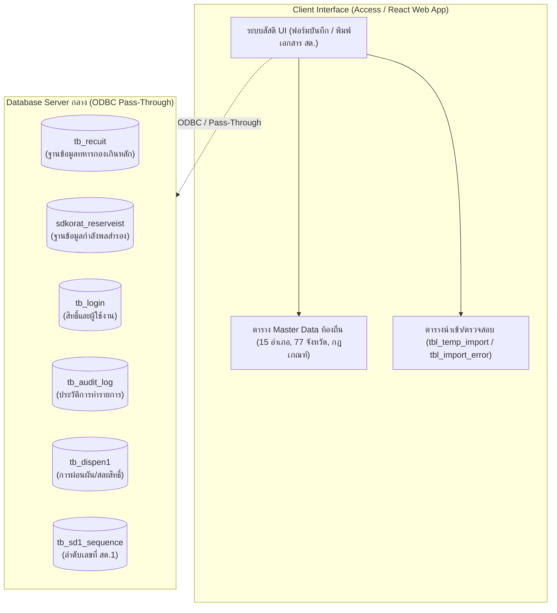
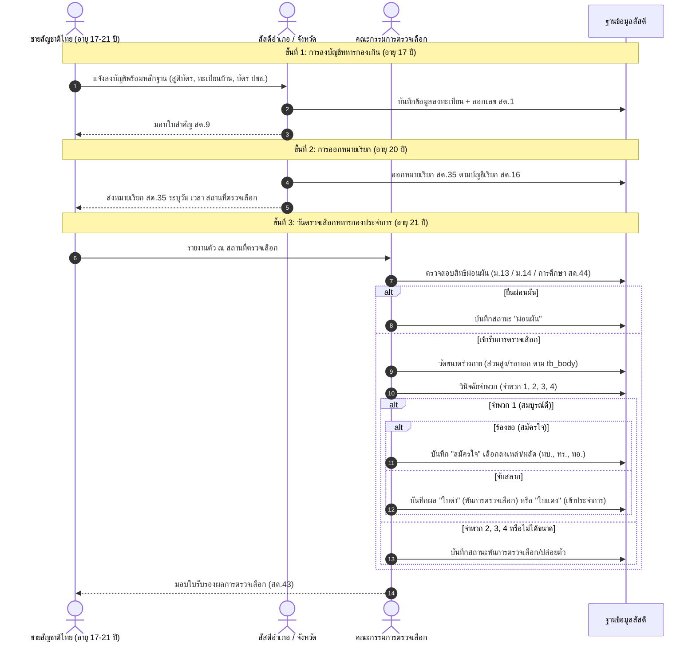

# เอกสารสรุปการวิเคราะห์ระบบงานสัสดีและโครงสร้างฐานข้อมูล
**โปรเจกต์:** SASSADEE 4.9 (64-bit Server) — สัสดีจังหวัดน่าน  
**ที่ตั้งไฟล์:** `C:\Users\User\Desktop\rea Snnd\SASSADEE 4.9 64 bit server จริง.accdb`  
**ขนาดไฟล์:** ~161.8 MB (169,660,416 ไบต์)  
**วันที่วิเคราะห์:** 26 ตุลาคม 2569  

---

## 1. บทสรุปผู้บริหาร (Executive Summary)

ไฟล์ `SASSADEE 4.9 64 bit server จริง.accdb` เป็นระบบสารสนเทศงานสัสดีที่พัฒนาด้วย Microsoft Access (Jet/ACE Engine) สำหรับจัดการกระบวนการเกณฑ์ทหารและการระดมสรรพกำลังของกระทรวงกลาโหม/กองทัพบก โดยเน้นพื้นที่รับผิดชอบของ **จังหวัดน่าน (15 อำเภอ)** ภายใต้เขตพื้นที่ **มณฑลทหารบกที่ 38 (มทบ.38)**

ระบบถูกออกแบบในลักษณะ **Client/Frontend Application** ที่มีตาราง Master Data และ Staging Data อยู่ภายในเครื่อง พร้อมเชื่อมโยงแบบ **Pass-Through Query / Linked Tables** ไปยัง Server ฐานข้อมูลกลางของหน่วยงาน

---

## 2. สถาปัตยกรรมระบบ (System Architecture)

### ตารางที่เชื่อมโยงไปยัง Server กลาง (Pass-Through Tables)
| ชื่อตาราง | ประเภท | หน้าที่การทำงาน |
| :--- | :--- | :--- |
| `tb_recuit` | PASS-THROUGH | ข้อมูลทหารกองเกินและผลการตรวจเลือกหลัก |
| `sdkorat_reserveist` | PASS-THROUGH | ทะเบียนกำลังพลสำรอง/ทหารกองหนุน |
| `tb_login` | PASS-THROUGH | บัญชีผู้ใช้งานระบบและระดับสิทธิ์ของเจ้าหน้าที่สัสดี |
| `tb_audit_log` | PASS-THROUGH | บันทึกประวัติการเข้าใช้งาน การแก้ไข และการสืบค้นข้อมูล |
| `tb_dispen1` | PASS-THROUGH | รายการผ่อนผันและข้อยกเว้นการรับราชการทหาร |
| `tb_sd1_sequence` | PASS-THROUGH | ระบบรันเลขที่ใบสำคัญ สด.1 ป้องกันการซ้ำซ้อน |

---

## 3. โครงสร้างฐานข้อมูลภายในไฟล์ (Local Tables Overview)

ฐานข้อมูลภายในไฟล์มีตารางและมุมมองรวม **92 รายการ** สามารถจัดกลุ่มตามภารกิจงานได้ดังนี้:

### 3.1 กลุ่มนำเข้าและตรวจสอบข้อมูล (Data Import & Staging)
* **`tbl_temp_import` (253 รายการในชุดตัวอย่าง)**: โครงสร้างข้อมูลสมบูรณ์ของทหารกองเกิน ประกอบด้วย 34 ฟิลด์สำคัญ:
  * **ข้อมูลประจำตัว:** `เลขประจำตัวประชาชน` (13 หลัก), `รหัสประจำตัว` (11 หลัก เช่น `55030147000`), `ชื่อ`, `นามสกุล`, `เกิดวันที่`, `เดือน`, `พ.ศ.`, `ศาสนา`, `อาชีพ`
  * **เอกสารทางทหาร:** `เลขที่ สด.1`, `ใบสำคัญเลขที่`, `ใบสำคัญเล่มที่`, `ใบสำคัญชั้นปี`, `ลงบัญชีทหารกองเกินวันที่/เดือน/พ.ศ.`
  * **ภูมิลำเนาทหาร:** `ภูมิลำเนาทหารเลขที่`, `หมู่ที่`, `ตำบล`, `อำเภอ` (เช่น บ้านหลวง, เมืองน่าน), `จังหวัด` (น่าน), `ถนน`
  * **ข้อมูลครอบครัว:** `ชื่อบิดา`, `บิดาสกุล`, `มารดาชื่อ`, `มารดาสกุล`
  * **คุณลักษณะเฉพาะ:** `ตำหนิ` (เช่น ข้อศอกซ้าย, ไฝมุมปาก), `ความรู้` (ระดับการศึกษา)
* **`tbl_import_error` (69,968 รายการ)**: บันทึกข้อผิดพลาดจากการนำเข้าไฟล์ Excel/CSV (ระบุ `excel_row`, `column_name`, `error_code`, `error_message`, `raw_value`)
* **`tbl_import_batch` / `tbl_import_audit`**: ข้อมูลประวัติการนำเข้าไฟล์แต่ละรอบ

### 3.2 กลุ่มข้อมูลการปกครองและภูมิศาสตร์ (Administrative Geography)
* **`tb_amphur` (15 อำเภอของจังหวัดน่าน รหัสจังหวัด 55):**
  1. `5501` เมืองน่าน
  2. `5502` แม่จริม
  3. `5503` บ้านหลวง
  4. `5504` นาน้อย
  5. `5505` ปัว
  6. `5506` ท่าวังผา
  7. `5507` เวียงสา
  8. `5508` ทุ่งช้าง
  9. `5509` เชียงกลาง
  10. `5510` นาหมื่น
  11. `5511` สันติสุข
  12. `5512` บ่อเกลือ
  13. `5513` สองแคว
  14. `5514` ภูเพียง
  15. `5515` เฉลิมพระเกียรติ
* **`tb_district` (7,428 รายการ)**: ข้อมูลตำบลทั่วประเทศ
* **`tb_province` (77 รายการ)**: ข้อมูลจังหวัด 77 จังหวัด
* **`tb_thanon` (8,439 รายการ), `tb_sois` (19,466 รายการ), `tb_trok` (1,900 รายการ)**: ฐานข้อมูลถนน ซอย ตรอก

### 3.3 กลุ่มหน่วยทหารและการบรรจุ (Military Units & Allocation)
* **`tb_soldier` (13 ประเภท)**: แผนกและผลัดส่งเข้ากองประจำการ
  * ทบ.1, ทบ.2, ทบ.1 ออนไลน์, ทบ.2 ออนไลน์ (กองทัพบก)
  * ทร.1 ออนไลน์ (กองทัพเรือ)
  * ทอ.1, ทอ.2, ทอ.1 ออนไลน์ (กองทัพอากาศ)
* **`tb_MTB` (35 มณฑลทหารบก)**: เช่น มทบ.38 (น่าน/แพร่), มทบ.37 (เชียงราย)
* **`tb_corps` (51 เหล่า)**: เช่น ทหารราบ, ทหารม้า, ทหารปืนใหญ่, ทหารช่าง, ทหารสื่อสาร
* **`tb_recuitunit`**: หน่วยรับการบรรจุทหารกองประจำการ

### 3.4 กลุ่มเกณฑ์มาตรฐานการตรวจเลือก (Screening Standards)
* **`tb_body` (37 เกณฑ์มาตรฐาน)**: ตารางความสัมพันธ์ระหว่าง ส่วนสูง (cm), ขนาดรอบอกปกติ/หายใจเข้า (cm เช่น `75/78`), และน้ำหนัก (kg)
* **`tb_shose` (15 ขนาด)**: ตารางเบอร์รองเท้าสำหรับแจกจ่ายทหารใหม่
* **`tb_doctor` (113 ท่าน)**: ทะเบียนแพทย์ทหารผู้ทำหน้าที่ตรวจร่างกาย
* **`tb_commit` (20 ท่าน)**: ทะเบียนคณะกรรมการตรวจเลือก (ประธาน, สัสดีจังหวัด, สัสดีอำเภอ)

### 3.5 กลุ่มการผ่อนผันและยกเว้น (Deferment & Exemption)
* **`tb_dispen` (21 หมวด)**:
  * เข้ากองประจำการ
  * ย้ายภูมิลำเนาทหาร
  * ตาย
  * พ้นฯ ประเภทที่ 1 / ประเภทที่ 2
  * ยกเว้นตาม ม.13 (1), (2), (3) (เช่น พระภิกษุสามเณร, คนพิการ)
  * ยกเว้นตาม ม.14 (1), (2) (เช่น ครู, นักเรียนเตรียมทหาร)
  * ผ่อนผันการศึกษา
* **`University` / `University1` (191 สถาบัน)**: รายชื่อมหาวิทยาลัยและสถาบันการศึกษา
* **`tb_board` (102 คณะวิชา)**: รายชื่อคณะ/สาขาวิชาสำหรับการบันทึกผ่อนผันการศึกษา

---

## 4. กระบวนการทำงานหลักของระบบงานสัสดี (Core Business Workflows)

---

## 5. แผนการพัฒนา React Web Application (`rea Snnd`)

เพื่อยกระดับระบบ Access เดิมขึ้นสู่ Web Application ที่ทันสมัย ใช้งานผ่านเบราว์เซอร์ได้ทั้งบน PC และแท็บเล็ต:

### 5.1 Tech Stack ที่แนะนำ
* **Frontend:** React 18+ (Single Page Application หรือ Next.js App Router)
* **Styling & UI:** Tailwind CSS + Lucide Icons
* **State & Data Table:** TanStack Table (รองรับการค้นหา ฟิลเตอร์ จัดเรียง 10,000+ แถว)
* **PDF / Print Engine:** CSS Print Media สำหรับพิมพ์แบบฟอร์ม สด.9, สด.43, สด.35
* **Backend Options:**
  1. *Direct API Service:* Node.js (Express / Fastify) หรือ Python (FastAPI) เชื่อมต่อไปยัง Database เดิม
  2. *Modern DB Migration:* ย้ายข้อมูล Master & Transaction ไปยัง PostgreSQL / MySQL

### 5.2 โครงสร้างโมดูลในระบบ React Web App
1. **Dashboard & Analytics:**
   * สรุปยอดทหารกองเกินประจำปีตรวจเลือก (แบ่งตาม 15 อำเภอของจังหวัดน่าน)
   * แผนภูมิแสดงอัตราการสมัครใจ vs การจับสลาก (ใบดำ/ใบแดง)
   * ยอดจำพวก 1, 2, 3, 4 และยอดผ่อนผัน
2. **ระบบทะเบียนทหารกองเกิน (สด.9 & สด.1):**
   * ค้นหาด่วนด้วย เลขประจำตัวประชาชน 13 หลัก, ชื่อ-สกุล, หรือภูมิลำเนา
   * หน้าบันทึกขึ้นทะเบียนใหม่พร้อมระบบตรวจสอบความถูกต้องเลขบัตร ปชช. 13 หลัก
   * พิมพ์ใบสำคัญ สด.9 ขนาดมาตรฐาน
3. **ระบบจัดการวันตรวจเลือก (สด.43 Engine):**
   * จุดคัดกรองและวัดขนาดร่างกาย: คำนวณความสมบูรณ์ร่างกายอัตโนมัติตามตาราง `tb_body`
   * บันทึกสถานะการผ่อนผัน (ม.13, ม.14, สด.44)
   * โหมดจับสลาก (สุ่มจับสลาก/บันทึกผลสลากดำ-แดง)
   * จัดสรรโควตาสังกัดทัพ (ทบ.1, ทบ.2, ทบ.ออนไลน์, ทอ.)
   * พิมพ์ใบรับรองผล สด.43
4. **ระบบออกเอกสารและรายงานราชการ:**
   * บัญชีเรียก สด.16, หมายเรียก สด.35
   * รายงานสรุปผลส่งกระทรวงกลาโหม/มทบ.38
5. **ระบบจัดการสิทธิ์และ Audit Log:**
   * บันทึกทุกความเคลื่อนไหวการสืบค้นและแก้ไขข้อมูลตามมาตรฐาน PDPA
